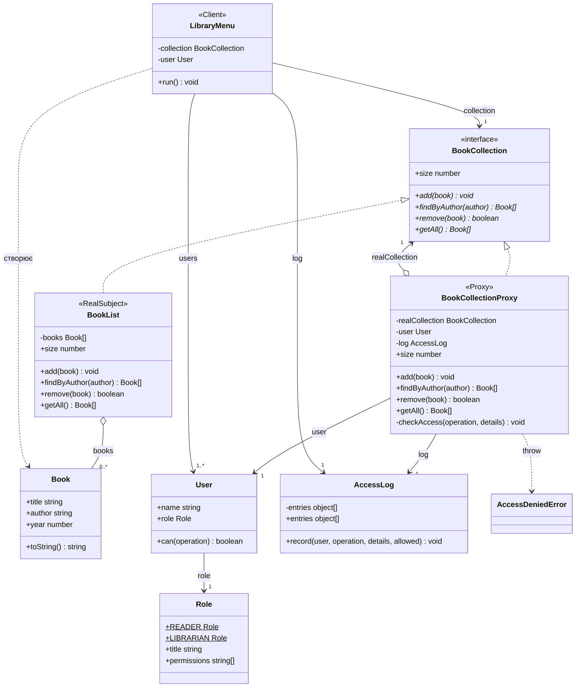

# Лабораторна робота №1. Основні шаблони проектування: Заступник (Proxy)

**Варіант 2.**

## Завдання

Розробити програму, яка працює зі списком книг. Розробити власний клас-колекцію, який містить усі необхідні методи (додавання, пошук, видалення). Пошук книги здійснювати за автором. Доступ до елементів колекції здійснити за допомогою шаблону Proxy (Заступник).

## Запуск

```bash
cd lab1.2
npm start
```

Потрібен Node.js 18 або новіший, сторонніх залежностей немає. Спершу програма питає, хто працює з колекцією (читач чи бібліотекар), далі відкриває меню: список усіх книг, пошук за автором, додавання, видалення, журнал звернень до колекції та зміна користувача.

## Як умову перенесено в код

- **Власна колекція** — клас [BookList](src/collection/BookList.js). Книги зберігаються в закритому масиві; є методи `add`, `findByAuthor`, `remove`, `getAll` і властивість `size`. Колекція не приймає дублікат (та сама назва й автор).
- **Пошук за автором** не залежить від регістру і шукає за частиною імені: запит «франко» знайде всі книги Івана Франка.
- **Книга** [Book](src/Book.js) заморожена (`Object.freeze`), тож отримане з колекції посилання не дає змінити її дані.
- **Доступ через заступника.** Меню ніколи не отримує `BookList` напряму — лише [BookCollectionProxy](src/collection/BookCollectionProxy.js). Справжню колекцію створює і бачить тільки [main.js](src/main.js).

Методичка наголошує, що заступник мало корисний без власної політики керування доступом. Тут це захисний заступник (Protection Proxy):

- **перевірка прав** — читач може лише переглядати й шукати, бібліотекар ще й додавати та видаляти ([User, Role](src/access/User.js)); заборонена операція до `BookList` не доходить, а клієнт отримує `AccessDeniedError`;
- **журнал звернень** — кожен виклик, дозволений чи ні, записується в [AccessLog](src/access/AccessLog.js) з часом, користувачем і деталями;
- **захист елементів** — списки книг заступник повертає замороженими, тому змінити колекцію в обхід його методів не можна.

## Учасники шаблону

| Роль у шаблоні | Клас | Призначення |
| --- | --- | --- |
| Subject (спільний інтерфейс) | [BookCollection](src/collection/BookCollection.js) | оголошує операції колекції; через нього працює клієнт |
| RealSubject (сервіс-об'єкт) | [BookList](src/collection/BookList.js) | справжня колекція, яка зберігає книги |
| Proxy (заступник) | [BookCollectionProxy](src/collection/BookCollectionProxy.js) | перевіряє права, веде журнал і делегує виклики `BookList` |
| Client | [LibraryMenu](src/ui/LibraryMenu.js) | меню; знає лише `BookCollection` |

Інтерфейсів у JavaScript немає, тому `BookCollection` — клас, який забороняє створювати себе напряму (`new.target`), а його методи кидають помилку, доки підклас їх не перевизначить. Заступник і справжня колекція наслідують його, як і вимагає методичка: «об'єкт-заступник і сервіс-об'єкт повинні або бути екземплярами загального суперкласу, або реалізовувати загальний інтерфейс».

Кожен метод заступника має однакову будову — перевірити доступ, потім делегувати:

```js
remove(book) {
  this.#checkAccess(Operation.REMOVE, String(book));
  return this.#realCollection.remove(book);
}
```

## Діаграма класів

Той самий зміст у форматі PlantUML — у файлі [class-diagram.puml](class-diagram.puml), готове зображення — [class-diagram.png](class-diagram.png) (намальоване Graphviz з [class-diagram.dot](class-diagram.dot)).



## Висновки про доцільність шаблону

Заступник тут доречний, бо до колекції потрібно додати керування доступом, не ускладнюючи саму колекцію. Це перший з мотивів, які називає методичка: «доступ до об'єкта, що надає сервіс, повинен контролюватися без додаткового ускладнення сервіс-об'єкта або прив'язки сервісу до політики контролю доступу».

1. **Колекція і політика доступу розділені.** `BookList` займається лише зберіганням і пошуком книг і нічого не знає про користувачів. Права й журнал зосереджені в заступнику. Щоб змінити правила (наприклад, дозволити читачам додавати книги), достатньо змінити ролі, не чіпаючи колекцію.
2. **Керування прозоре для клієнта.** Меню викликає ті самі методи інтерфейсу `BookCollection` і не знає, чи говорить із заступником, чи зі справжньою колекцією. Зміна користувача — це лише новий заступник над тією самою колекцією.
3. **Обійти контроль неможливо.** Справжня колекція недоступна клієнтові, а книги й списки, які повертає заступник, заморожені. Будь-яка зміна проходить через перевірку і потрапляє в журнал.
4. **Заступників можна поєднувати й замінювати.** Оскільки заступник сам реалізує `BookCollection` і приймає `BookCollection`, поверх нього можна поставити інший (наприклад, кешувальний або віддалений), не змінюючи ні меню, ні `BookList`.

Ціна рішення — додатковий клас і рівень непрямих викликів, а також новий вид винятку `AccessDeniedError`, який клієнтові доводиться обробляти. Методичка зазначає, що без нових видів винятків код клієнта зазвичай не мусить враховувати заступника; тут виняток з'являється саме тому, що заступник забороняє частину операцій.

Без політики доступу заступник лише переадресовував би виклики, і тоді він був би зайвим: клієнт міг би працювати з `BookList` напряму. Шаблон виправданий тим, що заступник додає власну поведінку — перевірку прав, журнал і захист елементів колекції.
