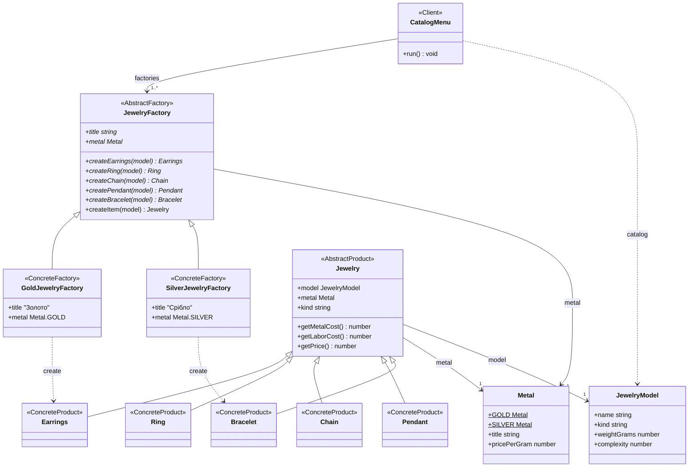

# Лабораторна робота №2. Породжуючі шаблони: Абстрактна фабрика (Abstract Factory)

**Варіант 1.**

## Завдання

Ювелірний завод виготовляє золоті та срібні прикраси у вигляді сережок, каблучок, ланцюжків, підвісок та браслетів. Модель кожного виробу може бути виконана як у золоті, так і у сріблі. Вартість моделі конкретного виробу залежить від виду дорогоцінного металу, ваги та складності роботи (золоті сережки однакової ваги можуть мати різну вартість). Вартість роботи конкретної моделі для золота і срібла однакова. Розробити програму для перегляду каталогу ювелірних виробів за категоріями «Золото» та «Срібло». Для створення об'єктів скористатись шаблоном Абстрактна фабрика (Abstract Factory).

## Запуск

```bash
cd lab2.1
npm start
```

Потрібен Node.js 18 або новіший, сторонніх залежностей немає. Меню пропонує обрати категорію «Золото» або «Срібло» і виводить таблицю виробів з вагою, складністю та розбивкою вартості на метал і роботу.

## Як умову перенесено в код

- **Модель не залежить від металу.** [JewelryModel](src/JewelryModel.js) описує задум: назву, вид, вагу, складність. Список моделей — [catalog.js](src/catalog.js).
- **Вартість металу** = вага × ціна грама металу ([Metal](src/Metal.js)). Золото коштує 1800 грн/г, срібло — 35 грн/г. Ціни умовні.
- **Вартість роботи** = складність × 250 грн. Ставка однакова для золота і срібла, як і вимагає умова. Тому вартість роботи в каталозі однакова для обох категорій для однієї моделі.
- **Однакова вага, різна вартість.** «Ніжність» і «Ніжність-2» важать по 3.0 г, але мають різну складність (2 і 4), тож коштують по-різному.
- **Категорія** — це фабрика. Вибрати «Золото» означає працювати з `GoldJewelryFactory`, а вибрати «Срібло» — з `SilverJewelryFactory`.

## Учасники шаблону

| Роль у шаблоні | Клас | Призначення |
| --- | --- | --- |
| AbstractFactory | [JewelryFactory](src/factories/JewelryFactory.js) | оголошує створення всіх п'яти видів виробів; `createItem` вибирає потрібний метод за видом моделі |
| ConcreteFactory | [GoldJewelryFactory](src/factories/GoldJewelryFactory.js), [SilverJewelryFactory](src/factories/SilverJewelryFactory.js) | виробничі лінії золота і срібла; кожна створює вироби свого металу |
| AbstractProduct | [Jewelry](src/products/Jewelry.js) | прикраса: вартість металу, роботи й загальна ціна |
| ConcreteProduct | [Earrings](src/products/Earrings.js), [Ring](src/products/Ring.js), [Chain](src/products/Chain.js), [Pendant](src/products/Pendant.js), [Bracelet](src/products/Bracelet.js) | конкретні види виробів; метал передається фабрикою |
| Client | [CatalogMenu](src/ui/CatalogMenu.js) | меню каталогу; працює лише з `JewelryFactory` і `Jewelry` |

Метал у продукт передає фабрика, а не клієнт. Тому виріб не може бути «золотою каблучкою зі срібною ціною»: усі вироби однієї фабрики мають один метал.

Абстрактних класів у JavaScript немає, тому `JewelryFactory` і `Jewelry` забороняють створювати себе напряму (`new.target`), а абстрактні методи кидають помилку, доки підклас їх не перевизначить.

## Діаграма класів

Той самий зміст у форматі PlantUML — у файлі [class-diagram.puml](class-diagram.puml), готове зображення — [class-diagram.png](class-diagram.png) (намальоване Graphviz з [class-diagram.dot](class-diagram.dot)).



## Висновки про доцільність шаблону

Абстрактна фабрика тут доречна, бо є кілька пов'язаних видів продуктів (п'ять видів прикрас), і їх потрібно створювати групами в межах однієї категорії. Методичка формулює умови застосування: система не має залежати від того, як створюються продукти, вхідні в сімейство взаємозалежні об'єкти мають використовуватися разом, а систему має конфігурувати одне з сімейств.

1. **Сімейство цілісне.** Вибір категорії визначає фабрику, і вона гарантує, що всі вироби з неї зроблені з одного металу. Неможливо випадково отримати золотий ланцюжок у срібному каталозі.
2. **Клієнт не знає про золото і срібло.** Меню працює з `JewelryFactory` і `Jewelry`. Щоб додати категорію (наприклад, платину), потрібен новий клас фабрики і рядок у `main.js`. Меню та каталог не змінюються.
3. **Вартість розділена на складові.** Метал і робота рахуються окремо, тож правило «робота однакова для золота і срібла» закладено в одному місці — `Jewelry.getLaborCost()`.

Ціна рішення — багато класів (п'ять продуктів і дві фабрики при двох металах) і складність додавання нового виду виробу: тоді доведеться змінити `JewelryFactory` і всі конкретні фабрики.

Для цього завдання вистачило б однієї функції з `if (metal === "gold")`, бо різниться лише ціна металу. Абстрактна фабрика виправдана тим, що вироби є окремими видами з різною поведінкою і їх родина має бути цілісною. Якби для кожного виду та металу потрібна була б різна логіка, шаблон став би ще доречнішим.
