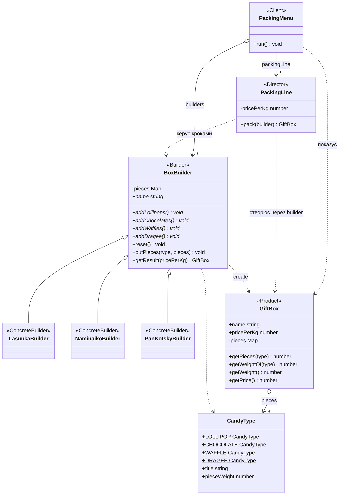

# Лабораторна робота №2. Породжуючі шаблони: Будівельник (Builder)

**Варіант 2.**

## Завдання

У фасувальному цеху кондитерської фабрики проводять пакування подарункових наборів цукерок трьох типів: економічний «Ласунка», стандартний «Наминайко» та екстра «Пан Коцький». У кожен набір входять льодяники, шоколадні цукерки, вафлі та драже. Вартість за кілограм солодощів вказується при запуску програми. Кожен набір складається з різної кількості солодощів кожного типу, але однаковий за вагою (допускається невелике відхилення). Оператор сам визначає, який набір запускає на пакування, а на дисплей виводиться назва набору, ціна та вага кожного виду солодощів. Реалізувати за допомогою шаблону Будівельник (Builder).

## Запуск

```bash
cd lab2.2
npm start
```

Потрібен Node.js 18 або новіший, сторонніх залежностей немає. Спершу програма питає вартість 1 кг солодощів, далі меню: оператор обирає один з трьох наборів, і програма виводить його склад і ціну.

## Як умову перенесено в код

- **Вид солодощів** — [CandyType](src/CandyType.js). Кожен вид має назву та вагу однієї штуки: льодяник 10 г, шоколадна цукерка 20 г, вафля 25 г, драже 5 г.
- **Набір** — [GiftBox](src/GiftBox.js). Зберігає кількість штук кожного виду. Вага рахується з ваги штук, ціна — з ваги і вартості 1 кг. Конструктор відхиляє набір, чия вага виходить за межі 500 ± 10 г.
- **Однакова вага, різний склад.** У кожного набору 500 г, але різна кількість штук. Наприклад, «Ласунка» має 30 льодяників, а «Пан Коцький» — 5 льодяників і 12 шоколадних цукерок.
- **Вартість 1 кг** передається в пакувальну лінію один раз при запуску і використовується для всіх наборів.

## Учасники шаблону

| Роль у шаблоні | Клас | Призначення |
| --- | --- | --- |
| Builder | [BoxBuilder](src/builders/BoxBuilder.js) | абстрактний будівельник: чотири кроки `addLollipops`, `addChocolates`, `addWaffles`, `addDragee` та `getResult` |
| ConcreteBuilder | [LasunkaBuilder](src/builders/LasunkaBuilder.js), [NaminaikoBuilder](src/builders/NaminaikoBuilder.js), [PanKotskyBuilder](src/builders/PanKotskyBuilder.js) | задають склад свого набору: скільки штук кожного виду |
| Director | [PackingLine](src/PackingLine.js) | пакувальна лінія: знає порядок кроків, а який набір складати, вирішує будівельник |
| Product | [GiftBox](src/GiftBox.js) | готовий набір, створюється лише через будівельника |
| Client | [PackingMenu](src/ui/PackingMenu.js) | меню оператора; обирає будівельника й отримує готовий набір |

Головна ідея: усі набори проходять одну й ту саму послідовність кроків, яку задає `PackingLine.pack`. Різниться лише те, що кожен будівельник записує на кроках. Тому додати четвертий набір означає написати ще один клас будівельника з чотирма методами, без зміни пакувальної лінії чи меню.

Абстрактних класів у JavaScript немає, тому `BoxBuilder` забороняє створювати себе напряму (`new.target`), а його абстрактні методи кидають помилку, доки конкретний будівельник їх не перевизначить.

`getResult` перевіряє, що додано всі чотири види солодощів. Якщо якогось бракує, набір не створюється.

## Діаграма класів

Той самий зміст у форматі PlantUML — у файлі [class-diagram.puml](class-diagram.puml), готове зображення — [class-diagram.png](class-diagram.png) (намальоване Graphviz з [class-diagram.dot](class-diagram.dot)).



## Висновки про доцільність шаблону

Будівельник тут доречний, бо набір складається з кількох частин, а правила їх складання однакові для всіх варіантів. Методичка формулює два умови застосування: алгоритм створення складного об'єкта не має залежати від того, з яких частин він складається, і процес конструювання має давати різні подання об'єкта. Обидві умови тут виконуються.

1. **Порядок кроків записано один раз.** `PackingLine.pack` визначає, що спершу йдуть льодяники, потім цукерки, вафлі й драже. Конкретні будівельники не мусять пам'ятати порядок, а пакувальна лінія не мусить знати склад кожного набору.
2. **Новий набір — новий клас, а не нова гілка в коді.** Щоб додати набір, достатньо класу з чотирма методами. Альтернатива з `if (type === "Ласунка")` змішувала б склад усіх наборів в одному місці, і кожна зміна складу вимагала б правки логіки пакування.
3. **Продукт не може бути неповним.** `GiftBox` створюється лише після того, як будівельник додав усі види солодощів, і лише якщо вага в межах допуску. Тобто некоректний набір не може потрапити до оператора.
4. **Спосіб подання знаходиться окремо.** Меню виводить набір у вигляді таблиці, але сам `GiftBox` цього не знає. Той самий набір можна показати іншим способом, не змінюючи збирання.

Ціна рішення — багато дрібних класів: для трьох наборів потрібно п'ять класів будівельників і допоміжних. Якби наборів було два і їх склад ніколи не змінювався, вистачило б простого масиву з описом складу й однієї функції.

Варто зауважити, що для цього завдання Будівельник краще підходить, ніж Абстрактна фабрика чи Фабричний метод. Ті створюють різні види об'єктів, а тут створюється один вид — набір — із різними складовими.
