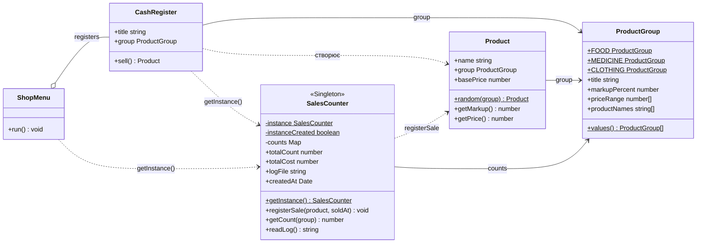

# Лабораторна робота №3. Породжуючі шаблони: Одинак з ранньою ініціалізацією

**Варіант 10.** У методичці до цієї роботи шість завдань, тому номер береться по колу: 10 → завдання №4.

## Завдання

Продемонструвати шаблон проектування Одинак з ранньою ініціалізацією на такому прикладі. Розробити програму, в якій існує лічильник для підрахунку кількості проданих товарів трьох груп (продукти харчування, ліки, одяг). Вартість продукту визначається випадковим чином з надбавкою 5% на продукти харчування, 10% на ліки та 15% на одяг. Окрім кількості проданих товарів об'єкт лічильника повинен зберігати сумарну вартість проданих товарів та файл, в якому повинен записуватись час продажу кожного товару і найменування групи товарів.

## Запуск

```bash
cd lab3
npm start
```

Потрібен Node.js 20.11 або новіший, сторонніх залежностей немає. Меню дозволяє продати товар через касу обраного відділу, продати кілька випадкових товарів, переглянути стан лічильника та вміст файлу журналу і перевірити, що лічильник єдиний.

Журнал продажів пишеться у файл `sales.log` у папці лабораторної. Він ведеться за поточний сеанс: при запуску файл очищується, тож кількість рядків у ньому завжди дорівнює лічильнику.

## Як умову перенесено в код

- **Три групи товарів і надбавки** описані в [ProductGroup](src/ProductGroup.js): 5%, 10% і 15%.
- **Випадкова вартість.** [Product.random](src/Product.js) обирає назву й базову вартість у межах, заданих для групи, а `getPrice()` додає надбавку. Суми зберігаються в копійках, щоб підсумок не накопичував похибку округлення.
- **Лічильник** [SalesCounter](src/SalesCounter.js) зберігає кількість проданого за групами, сумарну вартість і шлях до файлу, у який дописує рядок `час | група` при кожному продажу.
- **Клієнти одинака** — три каси [CashRegister](src/CashRegister.js), по одній на відділ. Жодна з них не отримує лічильник ззовні: кожна звертається до нього через `SalesCounter.getInstance()`.

## Як реалізовано ранню ініціалізацію

```js
export class SalesCounter {
  static #instanceCreated = false;
  static #instance = new SalesCounter();   // створюється під час завантаження класу

  static getInstance() {
    return SalesCounter.#instance;         // жодних перевірок — лише повернення
  }
}
```

Статичне поле ініціалізується в точці оголошення, як у прикладі з лекції (`private static Earth instance = new Earth()`), тому екземпляр з'являється тоді, коли Node.js завантажує модуль `SalesCounter.js`, — ще до запуску `main()` і до першого виклику `getInstance()`. Це видно в пункті меню «Перевірити єдиність лічильника»: час створення екземпляра не пізніший за час старту `main()`.

Закритих конструкторів у JavaScript немає, тому повторне створення блокує прапорець `#instanceCreated`: другий виклик `new SalesCounter()` завершується помилкою.

## Діаграма класів

Той самий зміст у форматі PlantUML — у файлі [class-diagram.puml](class-diagram.puml), готове зображення — [class-diagram.png](class-diagram.png).



## Висновки про доцільність шаблону

Одинак тут доречний, бо лічильник за змістом задачі має бути рівно один: продажі трьох кас повинні потрапляти в одні й ті самі підсумки та в один файл. Два екземпляри означали б два розбіжні підсумки і два записувачі в один файл. Шаблон гарантує єдиність на рівні класу, а `getInstance()` дає касам і меню спільну точку доступу, тож лічильник не доводиться передавати параметром через усі конструктори.

**Рання ініціалізація** для цієї задачі підходить краще за ліниву з трьох причин:

- лічильник потрібен програмі завжди і з першого ж продажу, тож відкладати його створення нема заради чого;
- `getInstance()` не містить перевірки `if (instance == null)`, отже нема чому зламатися при одночасному першому зверненні — у лекції заздалегідь створений екземпляр названо найпростішим розв'язком проблеми багатопотокового доступу;
- файл журналу готовий до запису ще до першого продажу.

Ціна ранньої ініціалізації: об'єкт і файл створюються навіть тоді, коли жодного продажу не буде, а параметри створення (наприклад, шлях до файлу) не можна передати під час роботи програми — вони мають бути відомі на момент завантаження класу.

Недоліки самого шаблону теж проявляються: лічильник є глобальним станом, а залежність `CashRegister` від нього прихована всередині методу `sell()` і не видна з конструктора. Через це касу не можна перевірити окремо від справжнього лічильника та його файлу, що в лекції названо ускладненням модульного тестування. Для невеликої навчальної програми це прийнятно; у більшій системі лічильник краще було б передавати касам явно.

Варто зауважити, що в Node.js модуль завантажується один раз, тому `export const counter = new SalesCounter()` теж дав би спільний об'єкт. Клас-одинак показує шаблон явно і додатково забороняє створити другий екземпляр через `new`.
