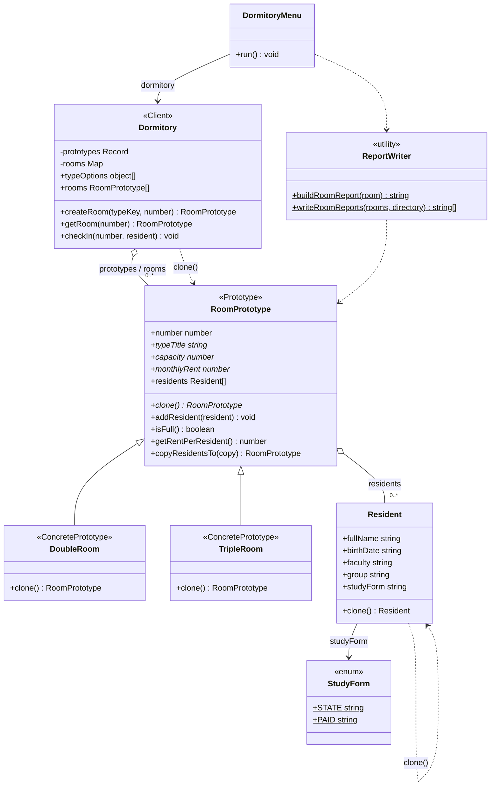

# Лабораторна робота №3. Породжуючі шаблони: Прототип (Prototype)

**Варіант 5.**

## Завдання

Розробити програму для обліку кімнат в гуртожитку. Кожна кімната може бути двомісною або трьохмісною. Необхідно зберігати інформацію про тип кімнати та всіх її мешканців: ПІБ, дата народження, факультет, група, форма навчання (державне замовлення чи за кошти фізичних осіб). Комендант гуртожитку повинен формувати звіт у вигляді текстового файлу про кожну кімнату (тип кімнати, кількість мешканців, квартплата для кожного мешканця та інформація про всіх мешканців). Поставлене завдання реалізувати за допомогою шаблону проектування Прототип.

## Запуск

```bash
cd lab3.2
npm start
```

Потрібен Node.js 18 або новіший, сторонніх залежностей немає. Меню коменданта дозволяє переглянути список кімнат, створити нову кімнату за зразком, поселити мешканця, переглянути звіт про кімнату та сформувати текстові звіти. Звіти записуються у папку `reports/`, по одному файлу на кімнату (`room-101.txt` тощо).

На старті є три кімнати з мешканцями, щоб одразу побачити облік.

## Як умову перенесено в код

- **Типи кімнат** — зразки-прототипи [DoubleRoom](src/rooms/DoubleRoom.js) і [TripleRoom](src/rooms/TripleRoom.js). Вони задають місткість і квартплату за кімнату на місяць (1200 і 1500 грн). Ці значення умовні.
- **Кімната створюється клонуванням зразка**, а не конструктором. Клон отримує номер і порожній список мешканців. Зразки самі ніколи не заселяються.
- **Мешканці** — [Resident](src/Resident.js). Це заморожений об'єкт з полями ПІБ, дата народження, факультет, група, форма навчання ([StudyForm](src/StudyForm.js)).
- **Квартплата для кожного мешканця** = квартплата кімнати ÷ кількість фактичних мешканців. Тобто в двомісній кімнаті з одним мешканцем він платить 1200 грн, з двома — по 600 грн. Це моє припущення: умова не каже, як ділити оплату.
- **Звіт** [ReportWriter](src/ReportWriter.js) формує текст про одну кімнату і записує його в окремий файл.

## Учасники шаблону

| Роль у шаблоні | Клас | Призначення |
| --- | --- | --- |
| Prototype | [RoomPrototype](src/rooms/RoomPrototype.js) | абстрактна кімната: спільна частина (мешканці, заселення, квартплата) і абстрактна операція `clone()` |
| ConcretePrototype | [DoubleRoom](src/rooms/DoubleRoom.js), [TripleRoom](src/rooms/TripleRoom.js) | конкретні типи кімнат; кожен реалізує `clone()` |
| Client | [Dormitory](src/Dormitory.js) | облік кімнат; знає зразки лише через `RoomPrototype` і створює кімнати клонуванням |

Клонування мешканців важливе. `copyResidentsTo` копіює кожного мешканця, а не передає посилання на той самий об'єкт. Інакше зміна мешканця в одній кімнаті змінила б і зразок, і всі інші клони. Лекція якраз застерігає про поверхневе копіювання: після `MemberwiseClone` змінені в клоні дані залишаються спільними з оригіналом.

Абстрактних класів у JavaScript немає, тому `RoomPrototype` забороняє створювати себе напряму (`new.target`).

## Діаграма класів

Той самий зміст у форматі PlantUML — у файлі [class-diagram.puml](class-diagram.puml), готове зображення — [class-diagram.png](class-diagram.png) (намальоване Graphviz з [class-diagram.dot](class-diagram.dot)).



## Висновки про доцільність шаблону

Прототип доречний, бо кімнати одного типу однакові за структурою і відрізняються лише номером та мешканцями. Методичка дає умови, які тут виконуються: клієнт не повинен залежати від того, як створюються продукти, а тип об'єкта визначається під час роботи програми.

1. **Новий екземпляр без знання конкретного класу.** `Dormitory` створює кімнату через `prototype.clone()` і не знає, чи це двомісна, чи трьохмісна. Нову кімнату додають через зразок без змін в обліку.
2. **Зразок налаштовано один раз.** Місткість і квартплата типу записані в зразку. Якщо ставка зміниться, достатньо змінити один клас, а не кожне місце створення кімнати.
3. **Клонування копіює стан.** Клон має мешканців, яких на момент клонування мав зразок, а далі живе незалежно. Це саме та властивість, для якої шаблон і призначений.

Ціна рішення — клонування має бути реалізоване в кожному класі. Лекція зазначає, що складно додати `Clone`, коли класи вже існують, а при вкладених об'єктах потрібне глибоке копіювання. Тут мешканці копіюються вручну в `copyResidentsTo`, і кожен новий вид кімнати має викликати його.

Для такого простого завдання можна було б обійтися фабричною функцією з параметром типу. Прототип виправданий тим, що зразок може нести в собі стан (наприклад, уже записаних мешканців або інші характеристики), і створення нової кімнати як копії цього зразка природніше, ніж побудова з нуля.
