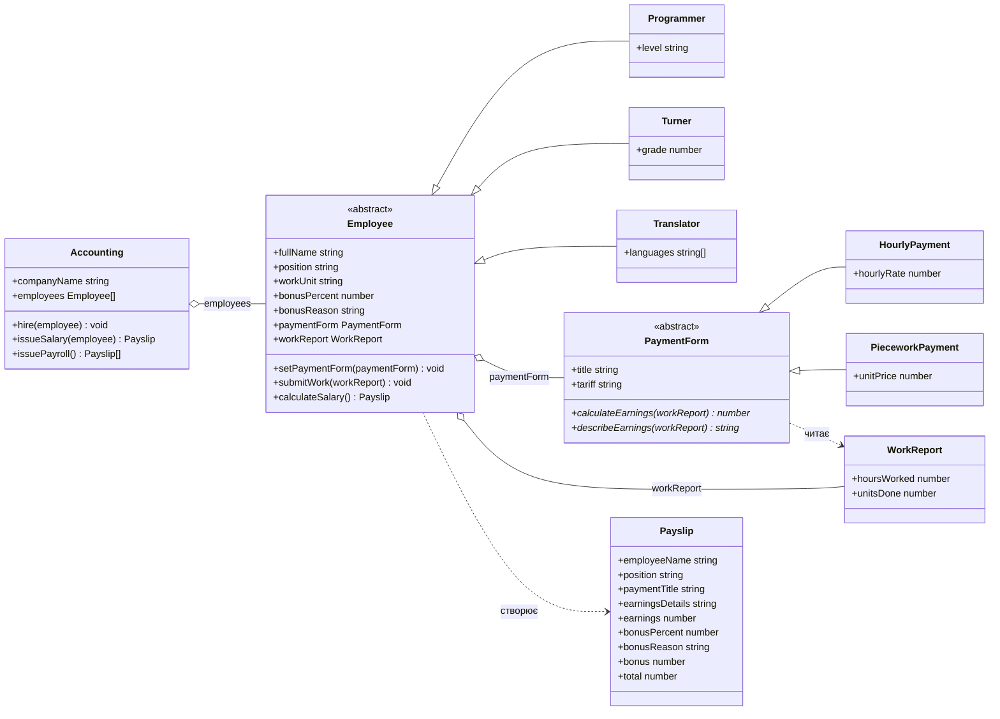

# Лабораторна робота №4. Структурні шаблони: Міст

**Варіант 10.** У методичці до цієї роботи шість завдань, тому номер береться по колу: 10 → завдання №4.

## Завдання

Написати програму БУХГАЛТЕРІЯ з використанням шаблону BRIDGE. На підприємстві працюють люди різних професій, у кожного з них є свої характеристики: ім'я, посада тощо. За допомогою шаблону проектування створити структуру класів, яка б дозволяла видавати заробітну плату працівникам двома способами: за кількість відроблених годин та за зроблену роботу (відрядна форма).

## Запуск

```bash
cd lab4
npm start
```

Потрібен Node.js 18 або новіший, сторонніх залежностей немає. Меню бухгалтера дозволяє переглянути штат, внести табель працівника, змінити йому форму оплати, отримати розрахунковий лист, сформувати платіжну відомість і прийняти нового працівника з будь-яким поєднанням професії та форми оплати.

## Як умову перенесено в код

- **Професії** — ієрархія працівників: [Programmer](src/employees/Programmer.js), [Turner](src/employees/Turner.js) (токар) і [Translator](src/employees/Translator.js). Кожна має власні характеристики (рівень, розряд, робочі мови), від яких залежать посада й надбавка.
- **Два способи оплати** — окрема ієрархія: [HourlyPayment](src/payment/HourlyPayment.js) рахує за відпрацьовані години, [PieceworkPayment](src/payment/PieceworkPayment.js) — за обсяг виконаної роботи.
- **Табель** [WorkReport](src/WorkReport.js) містить і години, і обсяг робіт; яке значення піде в розрахунок, вирішує форма оплати. Завдяки цьому одному й тому ж працівникові можна порахувати зарплату обома способами.
- **Бухгалтерія** [Accounting](src/Accounting.js) веде штат і видає зарплату у вигляді розрахункових листів [Payslip](src/Payslip.js).

Штат, ставки, розцінки та відсотки надбавок умовні.

## Учасники шаблону

| Роль у шаблоні | Клас | Призначення |
| --- | --- | --- |
| Abstraction | [Employee](src/employees/Employee.js) | працівник; зберігає посилання на форму оплати і має операцію `calculateSalary()` |
| RefinedAbstraction | [Programmer](src/employees/Programmer.js), [Turner](src/employees/Turner.js), [Translator](src/employees/Translator.js) | професії з власними характеристиками та надбавкою |
| Implementor | [PaymentForm](src/payment/PaymentForm.js) | форма оплати: примітивні операції `calculateEarnings()` і `describeEarnings()` |
| ConcreteImplementor | [HourlyPayment](src/payment/HourlyPayment.js), [PieceworkPayment](src/payment/PieceworkPayment.js) | почасова і відрядна оплата |
| Client | [Accounting](src/Accounting.js) | бухгалтерія; працює лише з `Employee` |

«Міст» — це поле `#paymentForm` у класі `Employee`. Операція абстракції `calculateSalary()` бере базове нарахування у форми оплати й додає надбавку професії:

```js
calculateSalary() {
  return new Payslip({
    // ...
    earnings: this.#paymentForm.calculateEarnings(this.#workReport),  // реалізація
    bonusPercent: this.bonusPercent,                                  // уточнена абстракція
  });
}
```

Форма оплати нічого не знає про професії, а професія — про те, як саме рахується базова сума.

## Діаграма класів

Той самий зміст у форматі PlantUML — у файлі [class-diagram.puml](class-diagram.puml), готове зображення — [class-diagram.png](class-diagram.png).



## Висновки про доцільність шаблону

У задачі дві незалежні осі змін: **професія** працівника і **форма оплати** його праці. Міст доречний саме тому, що розводить їх у дві окремі ієрархії.

1. **Класів стає менше, і їх кількість росте повільніше.** Якби обидві осі вирішувалися наслідуванням, для трьох професій і двох форм оплати знадобилося б 3 × 2 = 6 класів на зразок «програміст-погодинник» і «токар-відрядник». З мостом їх 3 + 2 = 5, а кожна нова професія чи форма оплати додає один клас замість цілого ряду. У лекції швидке зростання кількості класів названо ознакою того, що ієрархію слід розділити на дві.
2. **Обидві ієрархії розширюються незалежно.** Нова форма оплати (наприклад, оклад або змішана) — це один підклас `PaymentForm`, який одразу працює з усіма професіями; нова професія — один підклас `Employee`, який одразу підтримує всі форми оплати.
3. **Реалізацію можна змінити під час роботи програми.** Пункт меню «Змінити форму оплати праці» викликає `setPaymentForm()`, і той самий працівник з тим самим табелем отримує зарплату за іншою формою. З наслідуванням довелося б створювати нового працівника іншого класу.
4. **Клієнт ізольований від реалізації.** Бухгалтерія викликає `calculateSalary()` і не знає, як пораховано суму, тому зміни у формулах оплати її не зачіпають.

Ціна рішення — додатковий рівень непрямих викликів і більша кількість дрібних класів. Якби на підприємстві була одна форма оплати або професії не відрізнялися поведінкою, міст був би зайвим: вистачило б одного класу працівника.

За будовою рішення схоже на шаблон Стратегія, адже працівник делегує розрахунок замінюваному об'єкту. Відмінність у призначенні: тут розділено дві *ієрархії*, кожна з яких розвивається окремо, а абстракція не просто перенаправляє виклик, а будує власну операцію вищого рівня (надбавка, розрахунковий лист) на примітивних операціях реалізації.
