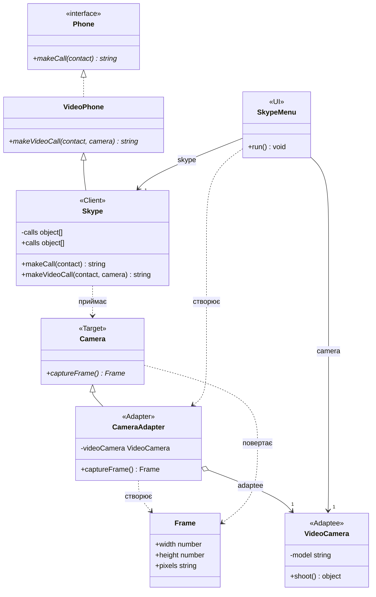

# Лабораторна робота №4. Структурні шаблони: Адаптер (Adapter)

**Варіант 5.**

## Завдання

Написати програму SKYPE з використанням шаблону ADAPTER. Маємо інтерфейс Phone, у якому оголошений метод Make Call (Зробити Виклик). Зробити можливим використання відео камери (клас VideoCamera) при відео виклику.

## Запуск

```bash
cd lab4.2
npm start
```

Потрібен Node.js 18 або новіший, сторонніх залежностей немає. Меню дозволяє зробити аудіодзвінок, відеодзвінок з камерою через адаптер, спробувати відеодзвінок без адаптера (щоб побачити, чому він потрібен) і переглянути журнал дзвінків.

## Як умову перенесено в код

- **Інтерфейс Phone** — [Phone](src/Phone.js) з методом `makeCall` («Зробити виклик»). Від нього успадковується [VideoPhone](src/VideoPhone.js), який додає `makeVideoCall`.
- **Skype** — [Skype](src/Skype.js) реалізує обидва методи. Аудіодзвінок працює одразу. Відеодзвінок очікує камеру з інтерфейсом `Camera`.
- **VideoCamera** — готова камера з власним API: метод `shoot()` повертає сирі дані у форматі сенсора ([VideoCamera](src/VideoCamera.js)). Skype її напряму не приймає, бо в неї немає `captureFrame()`.
- **Адаптер** [CameraAdapter](src/CameraAdapter.js) має інтерфейс `Camera`, а всередині тримає `VideoCamera`. Виклик `captureFrame()` він перекладає в `shoot()`, а сирі дані — у зрозумілий Skype кадр [Frame](src/Frame.js). Саму `VideoCamera` адаптер не змінює.

## Учасники шаблону

| Роль у шаблоні | Клас | Призначення |
| --- | --- | --- |
| Target | [Camera](src/Camera.js) | інтерфейс, який очікує відеодзвінок: `captureFrame()` |
| Client | [Skype](src/Skype.js) | працює з камерою лише через `Camera` |
| Adapter | [CameraAdapter](src/CameraAdapter.js) | переводить API `VideoCamera` в інтерфейс `Camera` |
| Adaptee | [VideoCamera](src/VideoCamera.js) | існуюча камера з несумісним API `shoot()` |

Інтерфейс `Phone` (Make Call) — окрема частина умови. Він задає, що Skype є телефоном. Адаптер стосується лише відеокамери.

Абстрактних класів у JavaScript немає, тому `Phone`, `VideoPhone` і `Camera` забороняють створювати себе напряму (`new.target`), а їхні методи кидають помилку, доки клас-нащадок їх не перевизначить.

## Діаграма класів

Той самий зміст у форматі PlantUML — у файлі [class-diagram.puml](class-diagram.puml), готове зображення — [class-diagram.png](class-diagram.png) (намальоване Graphviz з [class-diagram.dot](class-diagram.dot)).



## Висновки про доцільність шаблону

Адаптер доречний, бо маємо два несумісних інтерфейси: Skype очікує `Camera.captureFrame()`, а готова камера має `VideoCamera.shoot()` і повертає сирі дані. Методичка описує саме таку ситуацію: система підтримує необхідні дані й поведінку, але має невідповідний інтерфейс, і потрібно використати існуючий клас без зміни його коду.

1. **Камеру не змінюємо.** `VideoCamera` може бути сторонньою бібліотекою чи драйвером, якого немає в нашому проєкті. Адаптер вирішує проблему в одному місці, не торкаючись ні камери, ні Skype.
2. **Skype не залежить від конкретної камери.** Він знає лише `Camera`. Підключити іншу камеру можна, написавши для неї адаптер, без змін у Skype.
3. **Перетворення в одному місці.** Формат сенсора та розбір роздільної здатності знаходяться в `CameraAdapter`. Програма відеодзвінків працює з готовими `Frame`.

Демонстрація в меню показує ефект: прямий виклик `makeVideoCall(contact, videoCamera)` відхиляється з поясненням, що потрібен адаптер. З адаптером той самий дзвінок успішний.

Ціна рішення — ще один клас і непрямий виклик. Якщо від камери потрібен лише один метод і її API ніде більше не використовується, простіше було б змінити `Skype` напряму. Адаптер виправданий тим, що камера є зовнішньою залежністю і має залишатися незмінною.

Варто порівняти з Фасадом, Декоратором і Проксі. Декоратор додає функції об'єкту з тим самим інтерфейсом, Проксі контролює доступ. Адаптер змінює інтерфейс, щоб він відповідав очікуваному. Тут очікуваний інтерфейс — `Camera`, тому це саме адаптер.
